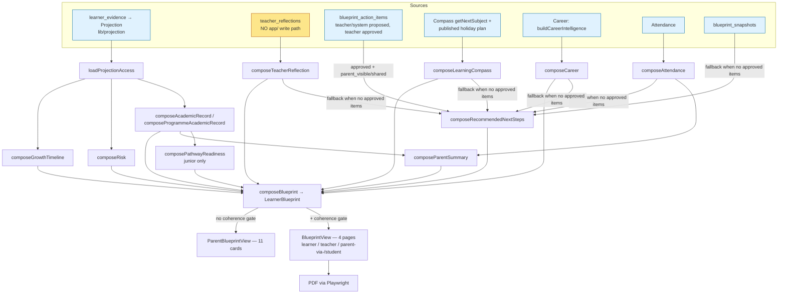

# Learner Progress Report — Pre-Implementation Audit (Phase 1)

**Date:** 2026-10-13
**Type:** Read-only investigation. No implementation authorized.
**Scope:** The existing Learner Blueprint / "Learner Progress Report" — data flow, the three stakeholder experiences, educational data integrity, and whether the proposed four-question / three-voice structure can be built on what exists.
**Only repository change made:** this file.
**Labels used:** VERIFIED (read in code or measured), PARTIALLY VERIFIED (some evidence, gap noted), UNVERIFIED (could not establish), RECOMMENDATION (opinion, not fact).

---

## 1. Executive verdict

**PROCEED WITH CONDITIONS.**

The four-question report can be built **as a presentation change over the existing canonical composition**. It needs no new tables, no AI calls and no new queries for Questions 1, 2 and 4, or for a printable (unrecorded) agreement strip.

Four facts change what "Phase 2" should mean, though:

1. **The three audiences already receive different accounts of the same learner, and the parent receives the weakest one.** The parent view skips the coherence gate that withholds contradictory reports from learners and teachers. It renders subject levels as bare numbers and raw subject keys, and it shows internal engineering notes as reader-facing text (§4, §5 — HIGH).
2. **Question 3's "who does what" data exists in the schema but is almost empty in real schools.** `blueprint_action_items` already has `learner_action`, `teacher_action`, `parent_support` and `review_date`. However, 1,146 of 1,147 rows, all 41 published teacher reflections and all 40 parent-visible action items are in fixture- or test-named schools. Teacher reflections have **no write path anywhere in `app/`**. For a real pilot learner today, Q2's teacher voice and Q3's teacher/parent rows would render empty (§7 — HIGH).
3. **Missing evidence can currently read as good news.** "Your learner is progressing well" is emitted when *no* action signals exist at all. "No current concern pattern is visible" is emitted when risk data is unavailable (§5 — HIGH).
4. **A recorded or signed agreement is a real backend feature, not a layout change.** No acknowledgement, signature or meeting-date capability exists. A static printed strip is safe and cheap; anything recorded is Option C (§8).

**Recommended shape (RECOMMENDATION):** Option B, a single pure presentation adapter in `lib/learnerBlueprint/` that turns the already-composed `LearnerBlueprint` into one four-question account with audience-specific wording. Both renderers would consume it.

Fix the parent-view integrity and jargon issues first. They are cheap, independent and visible today. Render Q3 role rows **only when real role-specific data exists**, with honest empty states otherwise. Treat teacher-reflection authoring and recorded agreements as separate, explicitly approved scopes.

---

## 2. Repository and working-tree baseline

| Item | Value | Status |
|---|---|---|
| Branch | `main` | VERIFIED |
| HEAD | `51aea26 docs: record schemes-bundle pricing + teacher-tool pricing/RoW decisions` | VERIFIED |
| Working tree | Not clean: untracked `Untitled-1.json`, `docs/decisions/2026-10-05-evidence-store-write-target.md`, `docs/manuscript/edutech-systems-design/`. None relate to this task. Treated as pre-existing user work, not touched. | VERIFIED |
| Tree after audit | `git status --porcelain` identical before and after the test run (diffed). Only this file has been added since. | VERIFIED |
| Destination | `docs/audits/` did not exist; target file did not exist (no overwrite) | VERIFIED |
| Instructions | Root `CLAUDE.md` only (no nested instruction files outside `.claude/worktrees`) | VERIFIED |
| Stack | Next.js `16.3.8` (pinned), React `19.2.3`, `@supabase/supabase-js ^2.104.0`, Zod `^4.4.3`, `playwright-core` + `@sparticuz/chromium` for PDF, Node `v24.12.0` | VERIFIED (`package.json`) |
| Tests | `npm test` → `scripts/run-standard-tests.mjs`. Runs the fixed `scripts/standard-tests.json` manifest only, never loads `.env.local`, and a manifest-rot guard runs first. Path arguments are **ignored**: it always runs the whole manifest. | VERIFIED |

**Lineage (for context, from git history):**
Academic Clinic (`lib/academicClinic/`, Feb–Jun 2026) → Blueprint ADR-0005/0006 (Jun–Jul) → 7-page report with a "School & Family Review" signature page (`b0a2ae7`, 2026-07-25) → 4-page report (Aug) → reader-facing rename to "Learner Progress Report" (`9c35667`, 2026-08-14) → Junior pathway-first career rule (`7d203b8`, 2026-10-06).

---

## 3. Verified architecture and data flow

### 3.1 Entry points (VERIFIED)

| Surface | File | Composer call | Renderer |
|---|---|---|---|
| Learner / teacher / parent / admin report | `app/student/blueprint/[learnerId]/page.tsx` | `composeBlueprintWithCoherence` (L87) — withholds on `FAIL` (L101-103) | `BlueprintView` with `viewer={primary}` (L156) |
| Parent "full picture" | `app/(parent)/child/[learnerId]/full/page.tsx` | `composeBlueprint` — **no coherence** (L53) | `ParentBlueprintView` |
| Parent home / history | `app/(parent)/child/[learnerId]/page.tsx`, `history/[snapshotId]/page.tsx` | `composeBlueprint` / stored snapshot | parent components |
| Legacy teacher link | `app/teacher/reports/blueprint/[studentId]/page.tsx` | none — resolves the legacy id, then redirects to the learner page | — |
| Class overview | `app/teacher/core-classes/[classId]/blueprint/page.tsx` | `classBlueprint.ts` | `ClassBlueprintTable` |
| PDF | `app/api/student/blueprint/[learnerId]/pdf/route.ts` | headless Chromium renders `/student/blueprint/{id}?export=pdf` with the caller's cookies (`lib/learnerBlueprint/pdfExport.ts`) | `BlueprintView` (pdf mode) |

### 3.2 Data flow

### 3.3 Field provenance (the fields named in the brief)

| Field | Origin | Populated by | Kind | Validated | Can be missing / stale | Persisted vs computed | Who sees it | When unavailable |
|---|---|---|---|---|---|---|---|---|
| `teacherReflection.recommendedSupport` (and `strengths`, `growthArea`, `learningHabits`, `holidayFocus`) | `teacher_reflections` via `lib/teacherReflection/reflection.ts` `findCurrent` → `composeTeacherReflection.ts` | `createDraft`/`publish` exist in lib, but **no caller in `app/`** (VERIFIED by search). The 41 published rows are all in fixture-named schools (VERIFIED, aggregate query). | Teacher-authored free text | Required fields + 2,000-char max (`reflection.ts` `validateFields`); content tone not validated (documented) | **Stale:** `findCurrent` = newest published version with **no term/year filter** (`teacherReflection.repository.ts` L92-104). BlueprintView shows it without a date. | Persisted, read at request time | Learner, parent, teacher (BlueprintView p.2/p.3; parent card) | BlueprintView hides box; parent card shows `unavailableReason` |
| `holidayFocus` | same row | same | Teacher-authored, optional | length only | same | same | same | omitted |
| Compass focus (`learningCompass.currentLearningFocus`, `nextRecommendedAction`) | `lib/compass/summary.ts` `getLearningCompassSummary` → `getNextSubject` | Compass algorithm | Calculated | Type only | `getNextSubject(...).catch(() => null)` — errors become "no focus" silently (summary.ts L33-36) | Computed per request | All | p.3 shows "There isn't yet a specific next step" |
| `learningCompass.learningReadiness` | none | — | Always `null` | — | Always missing | — | Parent card shows "not available" plus an internal note (§5) | — |
| `recommendedNextSteps` | `composeRecommendedNextSteps.ts` | **Path 1:** approved `blueprint_action_items` with `parent_visible`/`shared` → `toParentView` → **only `title` + `rationale` kept** (L53-70). `teacher_action`, `parent_support`, `review_date` and `success_indicator` are dropped. **Path 2 (fallback):** `composeParentActions` — fixed, deterministic rules over Compass / Reflection / Attendance / Career / Snapshot | Path 1: teacher-approved (proposal may be `system`). Path 2: deterministic selector | Path 1: lifecycle + coherence on approve. Path 2: none needed | Path 2 emits "Your learner is progressing well" when no signals exist (§5) | Computed per request | All (BlueprintView fallback, parent card) | `unavailable` on throw |
| `academicRecord.bySubject[].latestLevel` | Projection | Evidence pipeline | Calculated 1–4 | Typed `1\|2\|3\|4` | `trend: insufficient_data` when only one round | Computed | All | honest empty sentence (BlueprintView) / "No subject-level data yet" (parent) |
| `risk` | Projection via `composeRisk` | calculated | Calculated | — | see §5 H4 | Computed | BlueprintView only | "No current concern pattern…" (§5) |
| `parentSummary` | `composeParentSummary.ts` | deterministic templates | Calculated | — | — | Computed | **Parent card only** | card hidden |
| `pathwayReadiness` | `composePathwayReadiness` over `lib/pathwayCalculator.ts` | calculated | Calculated, `notes` + disclaimer | — | junior only by design | Computed | All | section absent |

---

## 4. Actual stakeholder experience comparison

| Capability | Learner (`/student/blueprint`, `viewer=student`) | Parent (`/child/[id]/full`) | Teacher (`/student/blueprint`, `viewer=teacher`) | Evidence |
|---|---|---|---|---|
| Same composed object | Yes | Yes (`composeBlueprint`) | Yes | VERIFIED — `composeBlueprint.ts` L82-191 |
| Coherence gate (withhold on contradiction) | **Yes** | **No** | **Yes** | VERIFIED — learner page L87/L101 vs parent full page L53 |
| Structure | 4 pages / 4 questions | 11 accordion cards (`ParentBlueprintView.tsx` L73-119) | 4 pages, plus Action Plan queue and Review link above | VERIFIED |
| Subject names | `subjectLabel()` display names | **raw `s.subject` key** (`sections.tsx` L83) | display names | VERIFIED |
| Level wording | KICD words for CBE, "Excellent/Good/Average/Below Average" for 8-4-4 (`curriculumVoice.ts`) | **bare number "3"** (`sections.tsx` L84); competencies "Level N" (L97) | KICD / 8-4-4 words | VERIFIED |
| Overall trend | prose | raw enum text e.g. `insufficient_data` with glyph (`sections.tsx` L68-69) | prose | VERIFIED |
| Interpretation prose (p.1/p.2) | Yes | **No** | Yes | VERIFIED |
| "One thing that matters most" | Compass next subject | Not shown as a priority; Compass shown as raw fields | same as learner | VERIFIED |
| Risk / "what we're watching" | Yes | **No** | Yes | VERIFIED |
| Growth movement | Yes | **No** (component comment still says `not_implemented` — stale) | Yes | VERIFIED |
| Parent summary ("What This Means For You") | **No** | Yes | **No** | VERIFIED |
| Attendance detail | Only as a follow-on when < 90% | Full counts card | same as learner | VERIFIED |
| Career | Grade-band framed prose, no notes | Raw fields incl. "Emerging Career Cluster", "AI Outlook", "Confidence", plus `notes` | same as learner | VERIFIED |
| Next-steps CTA links | Only career link | Parent links | None (`isActionDestinationValidForViewer`) | VERIFIED — `actions.ts` L102-106 |
| Teacher action plan | No | No | Yes (staff-only, `canManageLearnerRecord`) | VERIFIED |
| Voice | Third person ("{name}'s…"), sometimes parent-addressed text ("Your child…", "Your learner…") via fallback actions | "Your child" headings, mixed register | Third person | VERIFIED |
| Tests | 38 render tests in `BlueprintView.test.tsx` | **No render test for `ParentBlueprintView`** (only `sections.RecommendedNextStepsSection.test.tsx`) | shared | VERIFIED |

**Genuine inconsistencies (not audience design):** the coherence bypass; numeric versus worded levels; raw versus display subject names; no interpretation or risk for parents; and parent-addressed copy appearing in the learner's view. **Intentional differences that are correct:** viewer-gated links, the staff-only action plan, and the parent's attendance detail.

---

## 5. Educational data-integrity findings

| # | Severity | Finding | Evidence | User impact | Technical consequence | Disposition |
|---|---|---|---|---|---|---|
| H1 | HIGH | Parent report bypasses the coherence gate | `app/(parent)/child/[learnerId]/full/page.tsx` L53 calls `composeBlueprint`. The learner/teacher page withholds on `FAIL` (`app/student/blueprint/[learnerId]/page.tsx` L101-103). Critical rules include `narrative_alignment` (headline asserts decline while trend does not; `rules/narrativeAlignment.ts` L40-69) and `recommendation_alignment` (L44-48), which check exactly the parent summary and recommendations the parent card shows. | A parent can read a contradiction that the system deliberately hid from the learner and teacher | Two different publication rules for one learner. The cost argument for skipping it is documented in `composeBlueprint.ts` L69-76. | **Owner decision:** gate parent pages on coherence too (+1 query, 7 pure rule passes), or document why not |
| H2 | HIGH | Parent sees levels as bare numbers and raw subject keys, so curriculum vocabulary differs by audience | `components/blueprint/sections.tsx` L68-97 versus `BlueprintView.tsx` + `curriculumVoice.ts` L70-89 | Parent sees "Mathematics 3" or a raw key. Learner sees "Meeting Expectations". An 8-4-4 parent gets CBE-style numbers. | Same data, two vocabularies | Fix in presentation (reuse `resolveCurriculumVoice` + `subjectLabel`) |
| H3 | HIGH | Engineering notes and internal labels rendered to parents | `composeCareer.ts` L93-94 **always** appends "AI Outlook has no canonical cluster-level source yet — left null, not guessed." and "No canonical algorithm-version export exists yet…" because `getCareerBlueprintSummary` always returns `aiOutlook: null, version: null` (`careerIntelligenceOrchestration.ts` L423-425). `composeLearningCompass.ts` L75 always appends "Learning Readiness (ADR-0006 §3) has no Compass-owned source function yet…". `sections.tsx` renders `notes` (L131-133, L163-165), "AI Outlook:", "Confidence:" (L144-145), "Source: {sourceDomain}" and raw priority badges such as "critical" (L381-386). `ParentSectionCard.tsx` L55-58 shows `unavailableReason` text such as "No legacy student identity bridged… Career Intelligence cannot be queried." | Parent reads architecture notes, ADR numbers and product names, which undermines trust | `notes` mixes developer diagnostics with reader text | Stop rendering composer `notes` / `unavailableReason` / `sourceDomain` to readers; map to plain copy |
| H4 | HIGH | Missing evidence read as good news | `lib/parentExperience/actions.ts` L140, L267-280: with zero candidate signals (no Compass, no reflection, no attendance, no snapshot, no career), returns "Your learner is progressing well. There are no recommended actions at this time." `blueprintNarrative.ts` L228-229: when `risk` is **null/unavailable**, headline is "No current concern pattern is visible in this first snapshot." (also says "first snapshot" whatever the evidence maturity). | Parent or learner reassured when the system simply has no data | Absence of signal ≠ positive signal (contradicts Constitution Article II as cited across the codebase) | Distinguish "no data yet" from "no concern" in both places |
| M1 | MEDIUM | "The one thing that matters most right now" is the Compass algorithm's next subject, not a teacher decision or an evidence-ranked priority | `blueprintNarrative.ts` L305-309. `compass/summary.ts` → `getNextSubject` | Reader may take an algorithmic suggestion as the school's agreed priority | Suggested-vs-agreed ambiguity | Label provenance; prefer an approved action item when one exists |
| M2 | MEDIUM | Teacher reflection may be from a previous term, but is shown undated as current | `teacherReflection.repository.ts` L92-104 (no term filter). BlueprintView p.2 box (`BlueprintView.tsx` L549-553) shows no date. Parent card does show `publishedAt`. | Old opinion presented as current observation | `freshness: 'live'` is asserted regardless | Show the date and term; consider a term filter (owner decision) |
| M3 | MEDIUM | Junior learners see a **career field** label, and parents are told the child "is showing interest" | Junior `careerCluster` = family `categoryLabel` (`careerIntelligenceOrchestration.ts` L361-363). Parent card "Emerging Career Cluster: X" (`sections.tsx` L141). Parent action "Your child is showing interest in {cluster}" (`actions.ts` L237). p.3 follow-on "Career exploration — {cluster} — is worth exploring together" (`blueprintNarrative.ts` L318-323) shown for all bands. | Interest is never measured (cluster derives from capability/performance), so this is an unsupported claim. It may conflict with the agreed Junior pathway-first rule (`7d203b8`). | Job titles are correctly suppressed for Juniors (tests assert zero titles); field names are not | **Domain clarification needed:** is naming a career *field* permitted for G7–9? Remove "interest" wording regardless |
| M4 | MEDIUM | Role-specific action content exists but is discarded before presentation | `composeRecommendedNextSteps.ts` L53-70 keeps only `title` + `observation`. `ParentSafeActionView.whatTheSchoolWillDo`, `homeSupport`, `reviewDate` and `successIndicator` (`projections.ts` L25-36) never reach a reader. | Q3 data is lost even when a teacher wrote it | — | Carry these fields through (type extension, no schema) |
| L1 | LOW | Attendance threshold `90` defined twice | `composeParentSummary.ts` L20 and `BlueprintView.tsx` L58 | none today (equal values) | Violates the CLAUDE.md "no duplicate constants" rule | Import the shared constant |
| I1 | INFO | Rubric scale: the report uses KICD's 4-level labels (`ke-cbc.ts` L18-21). KJSEA uses 8 sub-levels (`lib/config/kjseaRules.ts` L95, EE1…). `composePathwayReadiness.ts` L43 already documents that 4 levels cannot separate EE1/EE2. | — | Correct for school-based formative reporting; may not match what families see on KJSEA results | — | **Domain clarification**, no change proposed |

**Mistake-risk checklist (brief §6):**
- Prediction as fact: mostly well handled (grade-band framing, hedging, provisional KJSEA disclaimer always rendered). Residual: M1, M3.
- Teacher opinion as measurement: reflection boxes are labelled "What the teacher has noticed" (good), but are undated in BlueprintView (M2).
- Missing evidence as weakness: well guarded (BlueprintView tests "never says no data / insufficient data"). The **reverse** risk, missing evidence as strength, exists (H4).
- Suggested action as agreed commitment: M1. Nothing in the UI distinguishes "system suggested" from "teacher approved" for the reader.
- Possible pathway as guaranteed future: guarded (junior "early, non-binding", senior "where the record points", KJSEA disclaimer).

---

## 6. Four-question structure feasibility

| | Q1 "Where are we now?" | Q2 "Going well / needs help" | Q3 "What do we do next?" | Q4 "Where is this leading?" |
|---|---|---|---|---|
| Existing support | BlueprintView p.1 (`describeAcademicPicture`, level grid, `curriculumVoice`) | p.2 (`describeVariation`, growth box, teacher box) plus p.3 risk box. Level-4 / level-1-2 grouping already exists (`groupSubjectsByLevel`). | p.3 priority + follow-ons; action items; parent actions | p.4 (`gradeBand`, career prose, `pathwayReadiness`, future evidence) |
| Authoritative data | Projection levels/trends | Projection levels + risk flags (system). Teacher reflection (human, near-empty in real schools). | Action items (role fields exist, near-empty in real schools), Compass next subject, reflection `recommendedSupport`/`holidayFocus` | Career summary, pathway calculator |
| Missing / unreliable | — | Teacher voice for real learners (no authoring UI) | Real role-specific rows; any notion of "this week" | Junior field-naming rule unclear (M3) |
| New computation? | No | No (reuse grouping) | No for rendering. Yes if roles must be *inferred* — **not recommended** | No |
| AI call? | No | No | No | No |
| Schema change? | No | No | No (columns exist). Only for recorded agreements (§8). | No |
| Contradiction risk | Parent view vocabulary (H2) | Risk-null wording (H4) | NO_ACTION_COPY (H4); suggested-vs-agreed (M1) | — |
| Minimum viable | Reuse p.1 for all audiences | Merge p.2 + risk; date the teacher box | See §7 | Reuse p.4 unchanged |

---

## 7. Learner / teacher / parent action-data audit (Question 3)

| Role | Source that is genuinely role-specific | Present today? | Real-school data |
|---|---|---|---|
| Learner | `blueprint_action_items.learner_action` (via `toLearnerView`, used only by `lib/studentHome/composeStudentHome.ts`, not the report). Compass next subject. | Learner action: not in report. Compass: yes. | 541 rows have `learner_action`, **all but at most 1 in fixture-named schools** |
| Teacher | `blueprint_action_items.teacher_action`. `teacherReflection.recommendedSupport`. | Reflection support shown as an unlabelled follow-on. `teacher_action` dropped (M4). | 75 rows with `teacher_action`; reflections 41, all fixture |
| Parent | `blueprint_action_items.parent_support` (`homeSupport`). `teacherReflection.holidayFocus`. `parentSummary.action` (attendance/decline templates). | `parent_support` dropped (M4). `holidayFocus` shown as a follow-on. | 396 rows with `parent_support`, fixture |

*Counts: read-only aggregate SQL against the live project, 2026-10-13. "Fixture-named" = school name matching mwatate / reference / test / demo / fixture / synthetic. That is a heuristic, hence PARTIALLY VERIFIED. Totals: 1,147 action items across 143 schools, 1,146 fixture-named; 40 parent-visible/shared, all fixture-named; 41 published reflections across 35 schools, all fixture-named.*

**Time horizons.** "This week" and "this month" **do not exist as data**. What exists: `blueprint_action_items.context` (`current_term | intervention | extension | end_of_term | holiday`) and `review_date` (67 rows). "This term" and "holiday" can be rendered honestly from `context`; "by {review_date}" can be rendered when set. "This week" would be an invented horizon → **do not introduce without a data decision.** (VERIFIED — migration `20260725120000_blueprint_action_items.sql`.)

**Conclusion.** A three-role Q3 is renderable without a schema change **only from approved action items**, which teachers create through the existing Review Workspace. Copying one generic recommendation into three roles would be fabrication. **RECOMMENDATION:** render a role row only when that role's field is non-empty. Otherwise show one honest line ("Your child's teacher hasn't set a home activity yet"). Real Q3 content depends on teachers actually using the action-plan workflow with `parent_visible`/`shared` visibility, which is an adoption task, not code.

---

## 8. Agreement and signature audit

| Capability | Exists? | Evidence |
|---|---|---|
| 1. Static printable signature area | **No (removed).** Existed in Academic Clinic v2 ("Action agreed with parent", teacher + parent signature lines) and the 7-page report's "School & Family Review" page (`b0a2ae7`). Absent from the current `BlueprintView` (search for `signature` finds only `teacherSignature` display). | VERIFIED |
| 2. Recorded agreement (meeting date, agreed status) | **No.** No table, column or type for meeting date, parent acknowledgement or agreement status. | VERIFIED (schema + search) |
| 3. Digitally signed agreement | **No.** | VERIFIED |
| 4. Commitment tracking over time | **Partially, staff side only.** Action items have approve/reject/defer lifecycle and history (`actionPlan/lifecycle.ts`). Teacher review records decisions `complete / needs_revision / reopen / defer / no_decision` with Assignment/Compass/Evidence snapshots (`blueprint_action_reviews`, `actionPlan/review.ts`). Status values `published / completed / reviewed` exist in the CHECK constraint but are **never set** by lifecycle code. No parent or learner participation. | VERIFIED |

**Smallest safe option (RECOMMENDATION):** a **static, print-only** strip under Q3: "Agreed on ____ · Class teacher ____ · Parent/guardian ____". No persistence, no DB, no claim that an agreement occurred.

Constraints:
- It changes PDF page count and layout (§10).
- Learner signature for Grades 7–9 (ages ≈12–15) is a school-policy question → **owner/school decision**. Default to teacher + parent only.
- Anything recorded (option 2+) needs: a new table with RLS, guardian identity verification, an audit trail, retention policy (the privacy page already lists "Learner Blueprint PDFs" retention), and parental-consent review. That is Option C, separately approved.

---

## 9. Bilingual support audit

| Question | Answer | Evidence |
|---|---|---|
| English + Kiswahili catalogues? | **Yes, but unused by UI.** `lib/i18n/` has `config.ts` (`en-KE`, `sw-KE`, …), `locales/en.ts` (178 lines), `locales/sw.ts` (170 lines), and `translations.ts` with a dependency-free `t(key, locale)`. | VERIFIED |
| Used by report UI? | **No.** Only `lib/billing/usage.ts`, `lib/organizations/quota.ts`, `lib/infrastructure/quota.ts`, `lib/config/countries.ts` import it. No component does. | VERIFIED |
| Persisted language preference? | **None found** (`lib/database.types.ts` has no language/locale column). | VERIFIED |
| Localized dates | Hardcoded `'en-KE'` (`BlueprintView.tsx` L327, `sections.tsx` L244/313-316) | VERIFIED |
| Dynamic content translation | None. Teacher text, narrative templates and career content are English-only. | VERIFIED |

**Smallest consistent implementation (RECOMMENDATION):** add four static question keys to the existing `en.ts`/`sw.ts` catalogues and render them **bilingually side by side** (English primary, Kiswahili secondary line). That needs no selector, no stored preference and no translation of teacher text. Teacher-authored observations stay in their original language, verbatim. They must never be machine-translated, so as not to turn hedged judgements into authoritative-sounding ones.

Candidate headings **for native-speaker / teacher review, not final:** "Tuko wapi sasa?" · "Nini kinaenda vizuri, na nini kinahitaji msaada?" · "Tufanye nini sasa?" · "Haya yanaelekea wapi?"

---

## 10. Mobile, print and accessibility audit

| Area | Finding | Status |
|---|---|---|
| Visual layout on real devices / PDF output | **Not rendered in this audit** (no dev server, no PDF generated, to avoid artifacts). Statements below are from code only. | UNVERIFIED |
| Page structure | 4 `PageShell` sections, `TOTAL_PAGES = 4` (`BlueprintView.tsx` L57). Test asserts exactly four pages. | VERIFIED |
| Print CSS | `app/globals.css` L187-226: forced `break-before: page` **only when** `data-blueprint-export-mode="pdf"`. No `break-inside: avoid` (deliberate, per comment). Browser Ctrl+P in screen mode gets no page structure. | VERIFIED |
| PDF coupling to headings | `pdfExport.ts` `BLUEPRINT_PDF_HEADINGS` (L8-13) is **waited on by exact accessible name** (L126-131). Renaming any page title without updating it makes every PDF export time out. | VERIFIED — key Phase 2 risk |
| PDF reachability | **No link to `/api/student/blueprint/[id]/pdf` anywhere in `app/` or `components/`** (search). Export is reachable only by typed URL. Filename `Learner_Blueprint_*.pdf` (route L98, L119). | VERIFIED |
| Long teacher text | 5 fields × up to 2,000 chars, with no `break-inside` rule. Spill onto an extra page is possible and would break the 4-page assumption. | UNVERIFIED (plausible) |
| Narrow screens | BlueprintView `px-4`, level grid `grid-cols-2 sm:grid-cols-3`. Parent table `w-full text-xs`, 3 columns. | PARTIALLY VERIFIED (classes only) |
| Colour dependence | Level badges carry text labels (good). Parent table trend shown **only as arrow glyphs** ↑↓→·↕ with no text or aria label (`sections.tsx` L35-41, L85). | VERIFIED — LOW |
| Semantics / keyboard | `h1` page title, `h2` per page, `nav` with aria-label. `ParentSectionCard` uses `aria-expanded` buttons. | VERIFIED |
| Tests | Component render tests via server rendering (`BlueprintView.test.tsx`). **No screenshot or browser tests** for the report. `pdfExport.test.ts` uses fakes. | VERIFIED |

**Feasibility:** the four-question layout maps 1:1 onto the existing four `PageShell`s, so print structure is preserved **if** `BLUEPRINT_PDF_HEADINGS` and the four-page test are updated in the same commit. A signature strip must fit inside page 3, or become an explicit page 5 (`TOTAL_PAGES` and tests change).

---

## 11. Privacy and authorization audit

| Control | Finding | Severity / Status |
|---|---|---|
| Report read access | `requireLearnerAccess` → `canViewLearnerRecord` (`lib/core/permissions.ts` L656-675): self, guardian, **current teacher of the student** (`isCurrentTeacherOfStudent`, L590-591), school admin roles. Matches the CLAUDE.md ownership rule. | VERIFIED — OK |
| Parent page | `requireParent` (L245-253) checks both identity spaces | VERIFIED — OK |
| PDF route | auth → school resolution → `requireLearnerAccess` → 401/403/404 (route L68-91). Renders through the same gated page with the caller's own cookies. `Cache-Control: private, no-store`. | VERIFIED — OK. Uses `console.error` (L128) instead of structured logging (LOW). |
| Teacher-only data | Action plan fetched only for `primary === 'teacher'`, under `canManageLearnerRecord`. `toParentView`/`toLearnerView` structurally exclude `teacherNotes`/`evidenceBasis`. | VERIFIED — OK |
| `blueprint_action_items` RLS | SELECT policy admits **any active staff member of the school** (`school_admin, headteacher, deputy_headteacher, teacher`) for all learners in that school, including `teacher_notes` (migration L-policy). App layer narrows to teacher-of-record. | MEDIUM. Intra-school over-breadth at the DB layer, versus the CLAUDE.md "currently teaches this student" rule. Not modified. |
| `teacher_reflections` RLS | Described as "school-isolation only" in later migrations' comments (`20260717160000_learner_portfolio.sql` L34/102) | PARTIALLY VERIFIED — same pattern as above |
| Legacy redirect page | `app/teacher/reports/blueprint/[studentId]` maps a legacy id to a Core id before any page-level auth, but `proxy.ts` L151-176 gates `/teacher/*` to teacher roles, and the target page enforces access. | LOW. Stale comment ("requireSchoolStaff"). |
| Presentation-layer exposure risk | Moving parent content into the shared BlueprintView would expose parent-only items (attendance counts, guardian names in `IdentitySection`, parent CTAs) to learner/teacher viewers unless the adapter is audience-aware. Conversely, BlueprintView risk text and p.2 interpretation would newly reach parents (intended, but a content decision). *Synthetic example:* a learner "Amina (fixture)" viewing her own report must not see "Guardians: <name> (mother)" if that card is merged naively. | RECOMMENDATION: audience field on the adapter output, with tests per audience |
| Agreement storage | none exists, so no exposure today | — |

No CRITICAL access-control weakness found in the report path.

---

## 12. Public-name migration inventory ("Learner Blueprint" → "Learner Progress Report")

**Already migrated (VERIFIED):** the report itself — `DOCUMENT_NAME = 'Learner Progress Report'` (`BlueprintView.tsx` L69) in header, footer and title, with a test asserting the document "never" calls itself a Blueprint.

| Reference | Class | Recommend |
|---|---|---|
| Marketing nav/pages: `app/(marketing)/layout.tsx` L46/L99; `insights/page.tsx` L216; `compass/page.tsx` L9/49/87/164; `teachers/page.tsx` L66/101/102; `schools/page.tsx` L99/168; `career-pathways/page.tsx` L112; `page.tsx` L120/165; `components/BlueprintCard.tsx` L25; `components/TeacherWorkspace.tsx` L10; `learner-blueprint/page.tsx` L35/159/169; `learner-blueprint/layout.tsx` L2/4 | A | Change wording; keep URL |
| Pricing `app/(marketing)/pricing/page.tsx` L64/175/224/240/392/643 | A (commercial copy) | Change, with owner sign-off (pricing language) |
| Legal `app/(marketing)/legal/privacy/page.tsx` L343/507/682/782 | A + C (legal text) | **Owner/legal review before change.** Keep the old name as "formerly" if changed. |
| Learner nav `components/student/JourneyLinks.tsx` L17; `app/dashboard/components/DashboardNavbar.tsx` L31 | A | Change label |
| Teacher buttons "Blueprint": `app/teacher/gradebook/[classId]/page.tsx` L101, `classes/[classId]/page.tsx` L3353, `assignments/[assignmentId]/page.tsx` L758; `core-office/page.tsx` L632; review workspace `learners/[learnerId]/blueprint/review/page.tsx` L95/97 | A (staff) | Change to "Progress Report" (staff may keep "action plan") |
| `components/blueprint/HistoricalBanner.tsx` L67 "Blueprint Version:"; history page L71 "Frozen Blueprint records" | A | Change, or hide version (2026-08-03 audit says version should not be public) |
| PDF filename `Learner_Blueprint_*.pdf`; headers `X-Blueprint-*` | A (filename) / B (headers) | Change filename; keep headers |
| Routes `/student/blueprint/**`, `/learner-blueprint`, `/api/student/blueprint/**`, `/api/teacher/blueprint/**`, proxy rules (`proxy.ts` L70-80, L166-239) | C (URLs, bookmarks, proxy) | **Keep.** Renaming breaks links, proxy carve-outs and PDF self-render. |
| DB `blueprint_snapshots`, `blueprint_payload`, `blueprint_action_items`, `blueprint_action_reviews`, `blueprint_compass_deliveries` | C (persisted) | **Keep** |
| `lib/learnerBlueprint/**`, types, `data-blueprint-*` hooks (PDF selectors) | B | **Keep** |
| Analytics events | none found | — |
| 110 test files, 225 docs | E / D | Keep. Update only assertions on changed copy. |

**No global replace.** Each change is copy-only. URLs, DB objects and the PDF selectors stay.

---

## 13. Performance and cost

| Item | Finding | Status |
|---|---|---|
| Composition cost | `composeBlueprint` runs 8 domain reads in parallel, then 5 more in parallel, plus 1–2 reads in `composeRecommendedNextSteps` (approved items, or latest snapshot). The coherence variant adds `listApprovedForLearner` + 7 pure rules (`composeBlueprint.ts` L69-76). | VERIFIED (structure; no timings measured) |
| Option A/B restructure | Pure functions over the already-composed object, so **zero added queries, zero AI calls** | VERIFIED by construction |
| Parent coherence (H1 fix) | +1 query per parent full-page view (and per parent home, if applied there) | VERIFIED |
| Duplicate work | BlueprintView computes its priority/follow-on selection inside the component (`BlueprintView.tsx` L355-397). ParentBlueprintView does none, so the two diverge in logic rather than in cost. | VERIFIED |
| Bundle | Both views are server components (no `'use client'` in `BlueprintView.tsx`/`ParentBlueprintView.tsx`) | PARTIALLY VERIFIED |
| AI | No AI call anywhere in the report path | VERIFIED |

No performance numbers are claimed.

---

## 14. Existing test coverage and check results

**Executed:**
- `npm test` (full STANDARD_SAFE manifest; path args ignored by design) → **1,457 tests, 1,457 pass, 0 fail, 0 skipped**, ~33 s. Working tree unchanged afterwards (porcelain diff).
- Read-only aggregate `SELECT … count(*)` queries against the live Supabase project (status/visibility/field-population counts, school-name pattern counts). No row content, no learner identifiers read or recorded.

**Not executed (reason):**
- `next build`: writes `.next/`, and the brief prohibits artifacts.
- `tsc --noEmit`: `tsconfig.json` has `incremental: true` (writes `tsbuildinfo`).
- Integration / DEEP tests (`composeBlueprint.integration.test.ts`, `reflection.integration.test.ts`, etc.): need `.env.local` and a DB target, which may write.
- PDF generation, dev server, screenshots: produce artifacts / need a running app.

**Coverage map:**

| Area | Covered? | Where |
|---|---|---|
| Data transformation | Yes | `composeBlueprint.pure.test.ts`, `composeRisk`, `composeGrowthTimeline`, `composeLearningStory`, `composePathwayReadiness`, `blueprintSectionNullGuards` |
| Subject-level presentation | Yes (BlueprintView) / **No (parent)** | `BlueprintView.test.tsx`, `curriculumVoice.test.ts` |
| Missing data | Yes for BlueprintView "never says no data". **No** test catches H4 (no-data → "progressing well"). | `BlueprintView.test.tsx`, `actions.pure.test.ts` |
| Junior / Senior | Yes | `gradeBand.test.ts`, BlueprintView grade-band tests, career junior tests |
| Permissions | Yes (route-level) | `classBlueprintAccess.test.ts`, PDF `route.test.ts`, viewer-link tests |
| Recommendations | Yes | `actions.pure.test.ts`, `composeRecommendedNextSteps.cutover.test.ts` |
| Report rendering | BlueprintView yes (38). **ParentBlueprintView no.** | — |
| Printing | Structural only (fakes) | `pdfExport.test.ts`, BlueprintView pdf-mode test |
| Localization | **None** | — |
| Agreement handling | **None** (no feature) | — |
| Legacy naming | Yes ("never a Blueprint" assertion) | `BlueprintView.test.tsx` |

---

## 15. Architectural options

| | **A — Restructure presentation in each view** | **B — Shared pure view-model adapter** | **C — New persisted data / backend** |
|---|---|---|---|
| Scope | Edit `BlueprintView` + `ParentBlueprintView` separately | One `lib/learnerBlueprint/progressReport.ts` (pure): `LearnerBlueprint × audience → four-question account`. Both views render it. | Agreement table, reflection authoring API/UI, possibly horizons |
| Files | ~6–8 | ~8–12 | 15+, migrations, RLS |
| Data integrity | Keeps today's divergence risk (two selection logics) | **One** selection logic, so H2/H4/M1 are fixed once and tested once | Highest, if done well |
| Regression risk | Medium (two places to keep in sync) | Medium-low (pure function, unit-testable without DB; views become thin) | High |
| Complexity | Low | Low-moderate: one new module justified by a **verified** defect (divergent accounts), not by aesthetics | High |
| Maintainability | Weak, since the divergence recurs | Good | — |
| Performance | No change | No change (pure) | New queries |
| DB change | No | No | Yes |
| AI | No | No | No (should remain no) |
| Compatibility | Snapshots render through the same views | Must accept old snapshot payloads (117 predate `pathwayReadiness`; 198 snapshots total) via `readSection` | — |

**RECOMMENDATION: Option B.** The extra abstraction is justified by evidence: the parent and learner/teacher accounts already disagree in vocabulary, interpretation, risk and priority. CLAUDE.md also places business logic in `lib/`, not in components, and today BlueprintView holds selection logic in the component. Option C items should be split out and approved individually.

---

## 16. Recommended minimum implementation scope (Phase 2, for approval)

Ordered so that each step ships value alone (small commits, per `/assess` discipline):

1. **Parent-view integrity fixes (no structure change):** stop rendering composer `notes` / `unavailableReason` / `sourceDomain` / raw priority to readers (H3). Use `subjectLabel` + `resolveCurriculumVoice` in the parent academic card (H2). Remove "showing interest" wording (M3). Add a `ParentBlueprintView` render test.
2. **Missing-evidence honesty (H4):** distinguish "no data yet" from "no concern / progressing well" in `composeParentActions` and `describeRiskForReader`. Tests for both.
3. **Owner decision applied:** coherence gate on parent pages (H1).
4. **Option B adapter** `lib/learnerBlueprint/progressReport.ts` (pure, explicit return types): Q1–Q4 for `learner | parent | teacher`. It reuses `blueprintNarrative` selection, carries action-item role fields through (M4), and labels provenance ("suggested by the system" vs "agreed by your teacher") (M1). It dates the teacher reflection (M2). Audience-specific voice: learner "you", parent "{name}"/"your child", teacher "{name}".
5. **Views:** BlueprintView renders the adapter's four questions in the existing four `PageShell`s. ParentBlueprintView renders the same four questions first, then the existing detail cards (attendance, portfolio, achievements, identity) under a "More detail" disclosure. Update `BLUEPRINT_PDF_HEADINGS` and the four-page test **in the same commit**.
6. **Q3 role rows:** render Learner / Teacher / Parent rows only from non-empty role fields, with an honest empty line otherwise. Horizon labels only from `context` / `review_date` (no "this week").
7. **Static print-only agreement strip** inside page 3 (no persistence, no learner signature unless the school decides otherwise).
8. **Bilingual headings:** four keys in `lib/i18n/locales/{en,sw}.ts`, rendered side by side, after native-speaker review.
9. **Public naming:** copy-only changes listed in §12 (excluding legal, pending review; excluding URLs/DB).

**Explicitly out of Phase 2 (separate approval):** teacher-reflection authoring UI/API, recorded/signed agreements, persisted language preference, a term filter on reflections, a PDF download button (product decision), RLS tightening on action items/reflections.

---

## 17. Files likely to change in Phase 2

- `lib/learnerBlueprint/progressReport.ts` (new, pure) + `progressReport.test.ts` (new) + `scripts/standard-tests.json` (register test)
- `components/blueprint/BlueprintView.tsx`
- `components/blueprint/blueprintNarrative.ts`
- `components/blueprint/BlueprintView.test.tsx`
- `components/parent/ParentBlueprintView.tsx` + new `ParentBlueprintView.test.tsx`
- `components/blueprint/sections.tsx` (stop rendering notes/source; worded levels)
- `components/parent/ParentSectionCard.tsx` (no raw `unavailableReason`)
- `lib/parentExperience/actions.ts` + `actions.pure.test.ts` (H4, M3 wording)
- `lib/learnerBlueprint/composeRecommendedNextSteps.ts` (carry role fields; additive optional fields on `ParentAction`)
- `lib/learnerBlueprint/pdfExport.ts` + `pdfExport.test.ts` (`BLUEPRINT_PDF_HEADINGS`)
- `app/(parent)/child/[learnerId]/full/page.tsx` (only if H1 gating is approved)
- `app/globals.css` (only if the agreement strip needs print rules)
- `lib/i18n/locales/en.ts`, `lib/i18n/locales/sw.ts`
- `components/blueprint/HistoricalBanner.tsx`, `components/student/JourneyLinks.tsx`, `app/dashboard/components/DashboardNavbar.tsx`, marketing pages in §12 (copy only)
- `app/api/student/blueprint/[learnerId]/pdf/route.ts` (filename only)

## 18. Must remain untouched

- All database schemas, migrations, RLS policies, triggers (`supabase/migrations/**`)
- `lib/learnerBlueprint/composeBlueprint.ts` orchestration and section set; `types.ts` existing fields (additive only)
- Projection / evidence: `lib/projection/**`, `lib/intelligence/evidenceLifecycle.ts`, `learner_evidence`
- `lib/learnerBlueprint/coherence/**` rules
- `lib/learnerBlueprint/actionPlan/lifecycle.ts`, `review.ts`, `projections.ts` visibility rules
- Career pipeline (`lib/learnerIntelligence/careerIntelligence*.ts`, `lib/career/**`), including the Junior no-job-title guarantee
- `lib/pathwayCalculator.ts`, `lib/config/kjseaRules.ts`
- Routes/URLs (`/student/blueprint/**`, `/learner-blueprint`, `/api/*/blueprint/**`), `proxy.ts`
- `data-blueprint-*` attributes (PDF selectors), stored `blueprint_payload` shape
- Legal privacy page text (until legal review)
- Any AI module (`lib/ai/**`)

---

## 19. Risks, unresolved questions, dependencies

**Owner decisions required:**
1. Gate parent pages on coherence (H1)? Recommended yes.
2. Junior (G7–9): may a career *field* label appear at all, or pathway-only (M3)?
3. Learner signature on the printed strip for G7–9? Teacher + parent only by default.
4. Should "the one thing that matters most" come from an approved action item first and Compass second (M1)?
5. Teacher reflection: filter to the current term, or show the date only (M2)?
6. Kiswahili wording: who reviews?
7. Pricing and legal copy renames: sign-off owner.

**Dependencies:**
- Real Q2/Q3 content for pilot learners depends on teachers writing reflections, which **cannot happen today: no authoring path exists**. It also depends on teachers approving action items with parent/shared visibility.
- The `BLUEPRINT_PDF_HEADINGS` exact-match coupling.
- 198 stored snapshots must keep rendering (`readSection` guards).

**Risks:**
- Merging content across audiences can leak parent-only fields to learners (§11). Mitigate with per-audience adapter tests.
- Overconfident translation of teacher judgements. Mitigate: never translate teacher text.
- Fixture-school heuristic may misclassify (§7). It does not change the conclusion that real data is near-empty.

---

## 20. Acceptance criteria (for a later implementation)

1. Learner, parent and teacher views of the same learner, composed at the same moment, show **identical subject names, identical level words, identical Q2 strengths/growth subjects and the identical Q3 priority**, differing only in voice and viewer-gated links. Tested per audience.
2. No reader-facing surface renders composer `notes`, `unavailableReason`, `owner`, `sourceDomain`, ADR references, "AI Outlook", "confidence" or "algorithm". Asserted by a string-scan test over rendered output for all three audiences.
3. With all sections unavailable, no view says or implies "progressing well", "no concern" or equivalent. It says evidence is not yet available.
4. Q3 never shows a role row whose source field is empty, and never duplicates one recommendation across roles.
5. Every Q3 item states its provenance (system-suggested vs teacher-agreed).
6. Junior learners: zero job titles (existing guarantee preserved), no "showing interest" claims, and field naming per the owner's decision.
7. Teacher reflection always shows its date (and term when known).
8. PDF export still produces the expected page count. `BLUEPRINT_PDF_HEADINGS` matches the rendered headings (test). The agreement strip is not clipped (verified by actually generating a fixture PDF and checking with `pdfinfo`).
9. All 198 existing snapshots render without throwing (test over representative old payload shapes).
10. Parent page coherence behaviour matches the owner's decision (test).
11. `npm test` green; `next build` green (per the standing rule that tsc alone is insufficient).
12. No migration, no new table, no AI call in the diff.

---

## 21. Final recommendation

**PROCEED WITH CONDITIONS.** Conditions: the owner resolves decisions 1–3 in §19 before step 3 / 4 / 7 of §16. Phase 2 starts with steps 1–2 (integrity and honesty fixes, independent of the redesign). Q3 is implemented to render honestly-empty role rows, accepting that real pilot learners will see little Q3 content until teacher authoring and action-plan adoption exist.

### Handoff

This audit modified **no application source code, no database schema, no production data and no configuration**. The only repository change is this file. Live-database access was limited to read-only aggregate counts. Implementation is not authorized by this document. The decision belongs to the project owner.
