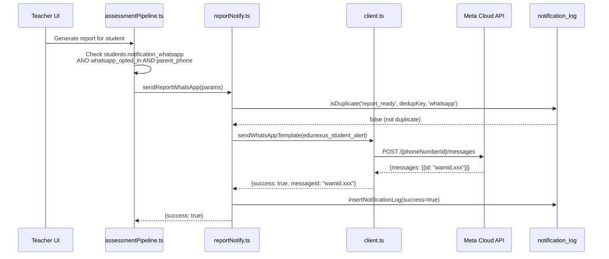
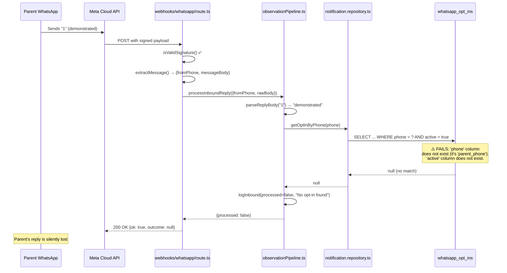
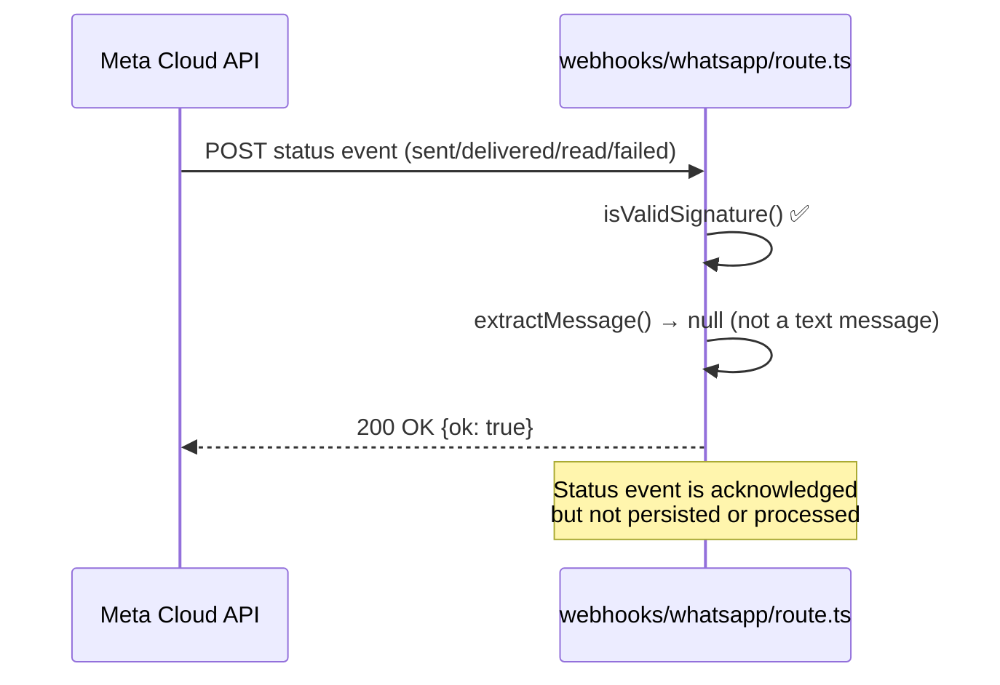
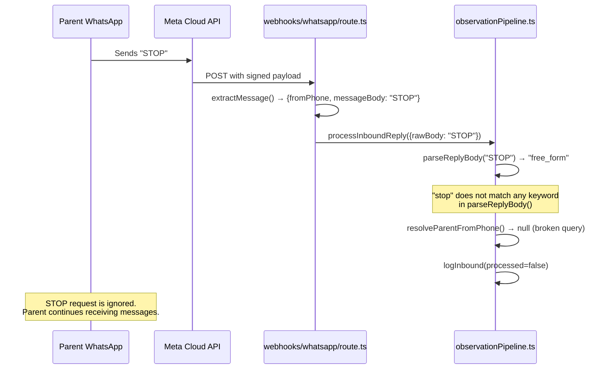

# WhatsApp Integration Deep Audit — 2026-10-31

**Auditor:** Claude Opus 4.6 (principal architect mode)
**Repository:** edunexus, branch `main`, commit `a9df2be`
**Classification:** Production-critical integration audit
**Mode:** Read-only investigation — no code modifications made

---

## A. Executive Summary

| Dimension | Status |
|---|---|
| **Outbound messaging (template sends)** | PARTIALLY VERIFIED — code paths are sound; template approval status on Meta Dashboard is UNVERIFIED |
| **Inbound reply processing** | BROKEN — two critical schema mismatches prevent all inbound parent resolution |
| **Delivery-status tracking** | NOT IMPLEMENTED — status callbacks are acknowledged but discarded |
| **Consent enforcement (outbound)** | FUNCTIONAL — `students.notification_whatsapp && whatsapp_opted_in && parent_phone` triple-gate on all outbound paths |
| **STOP / opt-out handling (inbound)** | NOT IMPLEMENTED — "STOP" replies are parsed as `free_form` and logged but do not deactivate consent |
| **End-to-end verified** | NO — outbound sends are the only path with production evidence (notification_log rows); inbound processing has never succeeded in production due to schema mismatch |

**Most consequential unresolved risks:**

1. **P0 — `whatsapp_opt_ins.active` column does not exist.** Both inbound resolution queries filter `.eq('active', true)` on a column absent from the schema. Every inbound parent lookup returns null. No parent reply has ever been processed.
2. **P0 — `whatsapp_opt_ins.phone` column does not exist.** Queries filter `.eq('phone', phone)` but the column is named `parent_phone`. Even if `active` were fixed, lookups would still fail.
3. **P1 — STOP handling is absent.** The parent pulse message includes "Reply STOP to unsubscribe" but no code path processes that keyword.
4. **P1 — Delivery-status callbacks are discarded.** Meta sends `sent`/`delivered`/`read`/`failed` status events; the webhook acknowledges them with 200 but takes no action.
5. **P2 — No retry mechanism.** `sendWhatsAppTemplate` makes one attempt with no retry, backoff, or queue.

**Final decision: NO-GO for inbound processing. CONDITIONAL GO for outbound-only use.**

---

## B. System Architecture Map

```
┌──────────────────────────────────────────────────────────────────┐
│                         EduNexus Platform                        │
│                                                                  │
│  ┌─────────────────────┐    ┌──────────────────────────────────┐│
│  │ OUTBOUND PATHS      │    │ INBOUND PATH                     ││
│  │                     │    │                                  ││
│  │ assessmentPipeline  │    │ POST /api/webhooks/whatsapp      ││
│  │   → reportNotify.ts │    │   → signature verification       ││
│  │                     │    │   → extractMessage()             ││
│  │ notify.ts           │    │   → processInboundReply()        ││
│  │   → sender.ts       │    │     → parseReplyBody()           ││
│  │     assignmentMarked│    │     → resolveParentFromPhone()   ││
│  │     alertCreated    │    │       → getOptInByPhone() ⚠️     ││
│  │                     │    │     → updateFromParentObservation ││
│  │ cron/parent-pulse   │    │     → recordEvidence             ││
│  │   → builder.ts      │    │   → buildAcknowledgement()       ││
│  │   → sendWhatsApp()  │    │   → sendWhatsApp() (ack reply)   ││
│  │                     │    │                                  ││
│  │ cron/academy-nudge  │    │ Re-export:                       ││
│  │   → sender.ts       │    │ /api/whatsapp/inbound → same     ││
│  │                     │    │                                  ││
│  │ growth/send.ts      │    └──────────────────────────────────┘│
│  │   → client.ts       │                                        │
│  └─────────┬───────────┘                                        │
│            │                                                     │
│  ┌─────────▼───────────┐    ┌──────────────────────────────────┐│
│  │ lib/whatsapp/       │    │ DATABASE                         ││
│  │   client.ts         │    │                                  ││
│  │   (Meta Graph API)  │    │ notification_log                 ││
│  │                     │    │ whatsapp_opt_ins      ⚠️ BROKEN  ││
│  └─────────┬───────────┘    │ whatsapp_inbound_log             ││
│            │                │ students (consent cols)          ││
│            ▼                │ student_alerts                   ││
│     Meta Cloud API          └──────────────────────────────────┘│
│     v25.0                                                        │
└──────────────────────────────────────────────────────────────────┘
```

---

## C. End-to-End Sequence Diagrams

### C1. Outbound Report Delivery



### C2. Inbound Parent Reply (BROKEN)



### C3. Delivery-Status Callback (NOT IMPLEMENTED)



### C4. STOP/Opt-Out Processing (NOT IMPLEMENTED)



---

## D. Evidence Register

### WA-001 — `whatsapp_opt_ins.active` column does not exist

| Field | Value |
|---|---|
| **Claim** | The `getOptInByPhone()` query filters on `.eq('active', true)`, but `whatsapp_opt_ins` has no `active` column |
| **Evidence** | Migration `20260520000000_whatsapp_layer.sql` creates the table with columns: `id`, `student_id`, `parent_phone`, `opted_in_at`, `opted_out_at`, `source`, `created_at`. No subsequent migration adds an `active` column. Generated `database.types.ts` (line 12771) confirms: Row type has no `active` field. |
| **Affected code** | `lib/repositories/notification.repository.ts:110` (`.eq('active', true)`), `app/api/webhooks/whatsapp/route.ts:192` (`.eq('active', true)`) |
| **Severity** | P0 — Critical |
| **Confidence** | CONFIRMED — static analysis of migration DDL, generated types, and application code |
| **Verification** | Compared all migration files, `database.types.ts` Row definition, and application query filters |
| **Impact** | Every `getOptInByPhone()` call returns null. No inbound reply is ever associated with a parent/student. The entire observation pipeline is dead. |
| **Unknown** | Whether production database has the column added manually outside migrations |

### WA-002 — `whatsapp_opt_ins.phone` column does not exist

| Field | Value |
|---|---|
| **Claim** | Queries filter `.eq('phone', phone)` but the column is named `parent_phone` |
| **Evidence** | Migration `20260520000000_whatsapp_layer.sql:48`: `parent_phone TEXT NOT NULL`. Generated types confirm `parent_phone`. Code queries `.eq('phone', phone)` at `notification.repository.ts:109` and `route.ts:191`. |
| **Affected code** | Same two files as WA-001 |
| **Severity** | P0 — Critical |
| **Confidence** | CONFIRMED |
| **Impact** | Even if WA-001 were fixed, lookups would still fail. Double-broken. |

### WA-003 — STOP keyword not handled

| Field | Value |
|---|---|
| **Claim** | Parent pulse messages include "Reply STOP to unsubscribe" (builder.ts:119), but no code processes STOP |
| **Evidence** | `parseReplyBody()` in `observationPipeline.ts:55-90` checks for "well", "struggled", "hard", "difficult", "didn't", "no time", "busy" — "stop" is not among them. Falls through to `free_form`. No separate STOP check exists in `route.ts` before the pipeline call. The opt-in route (`parent/whatsapp-optin/route.ts`) only handles dashboard-initiated opt-outs. |
| **Severity** | P1 — High |
| **Confidence** | CONFIRMED |
| **Impact** | Parents who reply STOP continue receiving weekly pulses. This violates Meta's WhatsApp Business Policy. Meta may block the business number. |

### WA-004 — Delivery-status callbacks discarded

| Field | Value |
|---|---|
| **Claim** | Meta sends delivery-status webhooks (`sent`, `delivered`, `read`, `failed`); the application discards them |
| **Evidence** | `route.ts:72-76`: `extractMessage()` returns null for non-message events, and the handler returns `{ok: true}` immediately. No `statuses` key extraction anywhere. No `message_status` table or column. `notification_log` records API acceptance but never delivery confirmation. |
| **Severity** | P1 — High |
| **Confidence** | CONFIRMED |
| **Impact** | Cannot distinguish "Meta accepted" from "parent received." Cannot detect template rejections or number-unreachable errors post-send. No delivery rate metrics. |

### WA-005 — No retry mechanism for failed sends

| Field | Value |
|---|---|
| **Claim** | `sendWhatsAppTemplate` makes exactly one HTTP call with no retry |
| **Evidence** | `client.ts:52-68` — single `fetch()` call, no retry loop. `client.test.ts:55-61` test explicitly documents: "no built-in retry for 429." No job queue or retry worker exists. |
| **Severity** | P2 — Medium |
| **Confidence** | CONFIRMED |
| **Impact** | Transient failures (network timeout, Meta 500, rate limit 429) permanently lose the message. The notification_log records the failure, but no mechanism re-sends. |

### WA-006 — `sendWhatsAppTemplate` does not catch transport errors

| Field | Value |
|---|---|
| **Claim** | A `fetch()` network failure (DNS, timeout, TCP reset) throws an uncaught exception from `sendWhatsAppTemplate` |
| **Evidence** | `client.test.ts:70-72` explicitly pins this: "a real network failure is NOT caught inside sendWhatsAppTemplate — it propagates to the caller." Fixed for `sendAssignmentMarkedWhatsApp` (has try/catch + failure log), but other callers vary. |
| **Severity** | P2 — Medium |
| **Confidence** | CONFIRMED |
| **Impact** | `sendWelcomeMessage` (sender.ts:270-313), `notifyOwnerMilestone` (sender.ts:349-381), `sendAcademyReflectionNudge` (sender.ts:398-439), and `sendAlertCreatedWhatsApp` (sender.ts:232-237) have varying levels of catch coverage. `sendAlertCreatedWhatsApp`'s catch block does NOT log a failure row to `notification_log` (unlike `sendAssignmentMarkedWhatsApp` which was fixed). |

### WA-007 — Outbound consent check does not verify `whatsapp_opt_ins` table

| Field | Value |
|---|---|
| **Claim** | Outbound sends check `students.notification_whatsapp && whatsapp_opted_in && parent_phone` but do NOT check `whatsapp_opt_ins.opted_out_at` |
| **Evidence** | `notify.ts:87`, `assessmentPipeline.ts:308` — consent gate reads from `students` table columns only. The `whatsapp_opt_ins` table's `opted_out_at` is set during dashboard opt-out but the outbound path reads `students.whatsapp_opted_in` instead. |
| **Severity** | P2 — Medium |
| **Confidence** | CONFIRMED — the two tables are updated together in the opt-out route (whatsapp-optin/route.ts:92-103), so they SHOULD stay consistent, but a race or partial failure could leave them divergent |
| **Impact** | If `students.whatsapp_opted_in` is not set to false during opt-out (e.g., partial DB failure), messages continue despite `whatsapp_opt_ins.opted_out_at` being set |

### WA-008 — Welcome message sent as freeform text outside 24h window assumption

| Field | Value |
|---|---|
| **Claim** | `sendWelcomeMessage` sends a freeform text message, not a template |
| **Evidence** | `sender.ts:270-313` — sends `type: 'text'` with `text: { body: messageBody }`. Comment says "Meta permits freeform outbound messages to numbers that have just opted in via a business flow." |
| **Severity** | P2 — Medium |
| **Confidence** | PLAUSIBLE |
| **Impact** | This is only valid during a user-initiated 24h conversation window. If the opt-in happens via dashboard (not a WhatsApp flow), there is no open conversation window, and Meta will reject the freeform message with error 131047 (outside allowed window). The opt-in source is `dashboard_prompt` — not a WhatsApp-initiated flow. |

### WA-009 — No phone-number uniqueness constraint on `whatsapp_opt_ins`

| Field | Value |
|---|---|
| **Claim** | Multiple opt-in rows can exist for the same phone number (different students, or duplicate inserts) |
| **Evidence** | `whatsapp_opt_ins` has no UNIQUE constraint on `parent_phone` or `(parent_phone, student_id)`. The opt-in route (whatsapp-optin/route.ts:137-142) does `.insert()` with no upsert or duplicate check. |
| **Severity** | P2 — Medium |
| **Confidence** | CONFIRMED |
| **Impact** | A shared family phone (common in Kenya — one phone, multiple children) creates multiple opt-in rows. `getOptInByPhone` with `.limit(1).maybeSingle()` returns an arbitrary one, potentially the wrong child. If WA-001/WA-002 were fixed, inbound replies could be associated with the wrong student. |

### WA-010 — `getAllActiveOptIns` does not filter on `opted_out_at`

| Field | Value |
|---|---|
| **Claim** | The parent pulse batch builder fetches opt-ins using `.not('opted_in_at', 'is', null)` but does NOT exclude rows where `opted_out_at IS NOT NULL` |
| **Evidence** | `notification.repository.ts:128-139` — the query has no `opted_out_at` filter. A parent who opted in then opted out will still receive weekly pulses. |
| **Severity** | P1 — High |
| **Confidence** | CONFIRMED |
| **Impact** | Opted-out parents receive weekly pulses. Combined with WA-003 (STOP not handled), there is no reliable way to stop receiving messages via the WhatsApp channel. The dashboard opt-out sets `students.notification_whatsapp = false`, which IS checked by `notify.ts` outbound paths, but the parent-pulse cron reads from `whatsapp_opt_ins` directly and bypasses that check. |

### WA-011 — Webhook GET verification uses plain string comparison

| Field | Value |
|---|---|
| **Claim** | The webhook verification handshake compares tokens with `===` instead of constant-time comparison |
| **Evidence** | `route.ts:35`: `token === expectedToken` |
| **Severity** | P3 — Low |
| **Confidence** | CONFIRMED |
| **Impact** | Theoretically allows timing-based token extraction, but the verification token is a one-time setup value with low attack surface since it's only used during webhook registration |

### WA-012 — `whatsapp_inbound_log` column-name divergence

| Field | Value |
|---|---|
| **Claim** | The migration DDL and generated types disagree on column names |
| **Evidence** | Migration `20260628_eios_foundation.sql` defines `from_phone`, `parent_user_id`, `error`. Generated types show `phone`, `parent_id`, `error_message`. The repository inserts match the generated types. |
| **Severity** | P3 — Low |
| **Confidence** | CONFIRMED — the divergence means either a later migration renamed the columns (not found in repo) or the production schema was altered outside migrations |
| **Impact** | If the production schema matches the migration DDL (not the generated types), all `insertWhatsAppInboundLog` calls fail with "column does not exist." However, since inbound processing is already broken by WA-001/WA-002, this has not been triggered. |

### WA-013 — Meta template approval status unverified

| Field | Value |
|---|---|
| **Claim** | The code references 4 templates: `edunexus_parent_update`, `edunexus_assignment_marked`, `edunexus_student_alert`, `edunexus_school_outreach`. Approval status cannot be verified without Meta Dashboard access. |
| **Evidence** | Memory note `project-whatsapp-production-send-verified.md` states "send creds fixed; templates unapproved" |
| **Severity** | P1 — High |
| **Confidence** | PLAUSIBLE (based on prior memory, not current verification) |
| **Impact** | Unapproved templates return Meta error 132001. Every template-based send fails. |

### WA-014 — `edunexus_parent_update` template body has only `{{1}}`

| Field | Value |
|---|---|
| **Claim** | The template registered in `docs/whatsapp-setup.md` is NOT documented — only `edunexus_assignment_marked`, `edunexus_student_alert`, `edunexus_school_outreach`, and `edunexus_academy_reflect` are documented. But `edunexus_parent_update` is used by `sendWhatsApp()` (generic send), the parent pulse cron, and growth outreach acknowledgements. |
| **Evidence** | `sender.ts:11-15` references the template. `docs/whatsapp-setup.md` does not include it. |
| **Severity** | P2 — Medium |
| **Confidence** | CONFIRMED |
| **Impact** | Template may not be registered in Meta BM. If not, all parent pulse sends and generic WhatsApp sends fail. |

---

## E. Root-Cause Investigation

**Reported symptom:** "The system can send a report, but the parent cannot reliably reply or have that reply processed."

### Ranked explanations (strongest evidence first):

| Rank | Explanation | Evidence strength | Status |
|---|---|---|---|
| 1 | **`whatsapp_opt_ins` query uses nonexistent columns `phone` and `active`** | CONFIRMED — static analysis of schema vs. code | ROOT CAUSE for inbound failure |
| 2 | **STOP keyword not handled** | CONFIRMED — code inspection | Contributing factor for consent violation |
| 3 | **Meta templates not approved** | PLAUSIBLE — prior memory note | Would cause outbound failure too |
| 4 | **Webhook subscription not configured or pointing to wrong URL** | UNVERIFIED — requires Meta Dashboard | Would cause no webhooks at all |
| 5 | **Delivery-status events discarded** | CONFIRMED but secondary | Would hide evidence of other failures |
| 6 | **`whatsapp_inbound_log` column mismatch** | CONFIRMED but secondary | Would cause logging failures, not processing failures |

**The primary root cause is WA-001 + WA-002.** The `getOptInByPhone()` function queries `whatsapp_opt_ins` with two nonexistent column names. This means:
- Every inbound reply lookup returns null.
- The pipeline logs "No opt-in found for phone" and exits.
- No parent observation is ever recorded.
- No acknowledgement is ever sent.
- The parent sees no response and concludes the system doesn't work.

This is not a "missing setup step" in Meta — it is a code bug in the Supabase query layer.

**The "missing setup step" previously discussed is most likely either:**
1. The `active` column that was never added by migration (code assumes it exists), OR
2. Meta webhook subscription configuration (unverifiable without Dashboard access)

Both must be addressed.

---

## F. Findings Register (Summary by Severity)

### P0 — Critical (2 findings)

| ID | Finding | Impact |
|---|---|---|
| WA-001 | `whatsapp_opt_ins.active` column missing | All inbound resolution broken |
| WA-002 | `whatsapp_opt_ins.phone` column missing (should be `parent_phone`) | All inbound resolution broken |

### P1 — High (4 findings)

| ID | Finding | Impact |
|---|---|---|
| WA-003 | STOP keyword not processed | Violates Meta WhatsApp Business Policy; risk of number block |
| WA-004 | Delivery-status callbacks discarded | No delivery confirmation; silent failures invisible |
| WA-010 | `getAllActiveOptIns` doesn't exclude opted-out parents | Opted-out parents receive weekly pulses |
| WA-013 | Template approval status unverified | All template sends may fail |

### P2 — Medium (5 findings)

| ID | Finding | Impact |
|---|---|---|
| WA-005 | No retry mechanism | Transient failures permanently lose messages |
| WA-006 | Transport errors uncaught in client.ts | Some callers crash; inconsistent failure logging |
| WA-007 | Outbound consent doesn't cross-check `whatsapp_opt_ins` | Potential consent bypass on partial failure |
| WA-008 | Welcome message sent as freeform outside conversation window | Likely rejected by Meta for dashboard opt-ins |
| WA-009 | No uniqueness constraint on opt-in phone + student | Shared phones resolve to wrong child |
| WA-014 | `edunexus_parent_update` template not documented in setup guide | May not be registered in Meta BM |

### P3 — Low (2 findings)

| ID | Finding | Impact |
|---|---|---|
| WA-011 | GET verification uses non-constant-time comparison | Minor timing attack surface |
| WA-012 | `whatsapp_inbound_log` column names diverge between migration and types | Logging may fail if prod schema matches migration DDL |

---

## G. Test Coverage Matrix

| Scenario | Expected behaviour | Existing test | Actual behaviour | Missing | Severity if fails |
|---|---|---|---|---|---|
| Valid webhook GET verification | Returns challenge | ✅ route.test.ts | ✅ Correct | — | P1 |
| Invalid verification token | 403 | ✅ route.test.ts | ✅ Correct | — | P1 |
| Valid signed POST (status event) | 200, no processing | ✅ route.test.ts | ✅ Correct | — | P1 |
| Invalid POST signature | 401 | ✅ route.test.ts | ✅ Correct | — | P0 |
| Malformed JSON | 400 | ✅ route.test.ts | ✅ Correct | — | P2 |
| Meta Cloud API message extraction | Pipeline receives message | ✅ route.test.ts | ✅ Correct | — | P1 |
| Twilio format extraction | Pipeline receives message | ✅ route.test.ts | ✅ Correct | — | P2 |
| Pipeline throws | 200 returned (no Meta retry) | ✅ route.test.ts | ✅ Correct | — | P1 |
| Meta API 2xx success | success=true with messageId | ✅ client.test.ts | ✅ Correct | — | P1 |
| Meta API error in 200 body | success=false | ✅ client.test.ts | ✅ Correct | — | P1 |
| Meta API 400/401/429/500 | success=false | ✅ client.test.ts | ✅ Correct | — | P1 |
| Network failure (fetch throws) | Propagates to caller | ✅ client.test.ts | ✅ Documented | — | P2 |
| Missing credentials | success=false, no fetch | ✅ client.test.ts | ✅ Correct | — | P1 |
| Transport failure logging | notification_log row created | ✅ integration test | ✅ Fixed | — | P2 |
| **Duplicate inbound event** | No duplicate side effects | ❌ | Unknown | Test needed | P2 |
| **Unknown sender (no opt-in)** | Logged, no data disclosure | ❌ | Logs "No opt-in found" | Test passes accidentally (WA-001 makes ALL lookups fail) | P1 |
| **STOP request** | Opt-out enforced | ❌ | Parsed as free_form, no effect | Test + implementation needed | P1 |
| **Shared parent phone** | Correct child resolved | ❌ | Returns arbitrary child | Test + fix needed | P2 |
| **Meta API timeout** | Failure recorded, retry | ❌ | Thrown to caller | Test needed | P2 |
| **Duplicate outbound trigger** | Blocked by dedup | Partial (dedup logic exists) | Works for successful sends | Edge case: failed send can be retried (dedup only checks success=true) | P3 |
| **Delivery status callback** | Status persisted | ❌ | Acknowledged, discarded | Implementation + test needed | P1 |
| **Out-of-order status callback** | Consistent state | ❌ | N/A (not implemented) | Implementation needed | P2 |
| **Cross-school lookup** | Access denied | ❌ | N/A (inbound broken) | Test needed after fix | P1 |
| **Database failure during processing** | No false success | ❌ | Pipeline catches and returns processed=false | Test needed | P2 |

---

## H. Remediation Plan

### Phase 1 — Immediate security and consent (blocks all other work)

| Fix | Problem | Files | Dependencies | Risk | Verification |
|---|---|---|---|---|---|
| H1.1 Add STOP handling before pipeline | WA-003 | `route.ts` or `observationPipeline.ts` | None | Low — new code path before existing logic | Send "STOP" to webhook, verify opt-out record created and 200 returned |
| H1.2 Fix `getOptInByPhone` column names | WA-001, WA-002 | `notification.repository.ts:109-110`, `route.ts:191-192` | Verify prod schema first | Medium — may need migration if `active` was never added to prod | Query returns correct opt-in row for known phone |
| H1.3 Add migration for `active` column OR remove filter | WA-001 | New migration OR code change | Determine whether `active` is needed (answer: `opted_out_at IS NULL` serves the same purpose) | Low | Column exists or filter removed |
| H1.4 Filter opted-out rows in `getAllActiveOptIns` | WA-010 | `notification.repository.ts:128-139` | None | Low | Parents with `opted_out_at` not returned |

### Phase 2 — Minimum viable inbound/outbound reliability

| Fix | Problem | Files | Dependencies | Risk | Verification |
|---|---|---|---|---|---|
| H2.1 Verify/register all 5 templates in Meta BM | WA-013, WA-014 | Meta Dashboard | Meta account access | None (read-only until submit) | All templates show "Approved" status |
| H2.2 Add uniqueness constraint on `(parent_phone, student_id)` | WA-009 | New migration | Check for existing duplicates first | Medium — existing duplicates must be cleaned | Duplicate insert returns conflict |
| H2.3 Handle shared-phone multi-child resolution | WA-009 | `observationPipeline.ts` | H2.2 | Medium | Inbound reply disambiguates or asks parent which child |
| H2.4 Verify `whatsapp_inbound_log` column names match prod | WA-012 | Compare migration DDL to prod schema | Prod DB access | Low | INSERT succeeds |
| H2.5 Convert welcome message to template | WA-008 | `sender.ts`, Meta BM | Template approval | Low | Welcome sends succeed from dashboard opt-in |

### Phase 3 — Status tracking and idempotency

| Fix | Problem | Files | Dependencies | Risk | Verification |
|---|---|---|---|---|---|
| H3.1 Parse and persist delivery-status callbacks | WA-004 | `route.ts`, new `message_statuses` table or `notification_log` update | Migration | Medium | Status events update notification_log |
| H3.2 Add idempotency for inbound webhooks | Duplicate events | `route.ts` | H1.2 | Low | Duplicate POST produces no duplicate DB rows |
| H3.3 Persist Meta message ID on all outbound sends | WA-004 prerequisite | `sender.ts`, `notification.repository.ts` | None | Low | `notification_log.whatsapp_message_id` populated |

### Phase 4 — Observability and recovery

| Fix | Problem | Files | Dependencies | Risk | Verification |
|---|---|---|---|---|---|
| H4.1 Add retry queue for transient failures (429, 500, network) | WA-005 | New `lib/whatsapp/retryQueue.ts` or use existing job queue | Queue infrastructure | Medium | Failed sends retried with exponential backoff |
| H4.2 Wrap `sendWhatsAppTemplate` in try/catch | WA-006 | `client.ts` | None | Low — callers already handle Result type | Network error returns `{success: false}` instead of throwing |
| H4.3 Add structured logging for webhook events | Observability | `route.ts` | None | Low | Operator can trace message lifecycle |
| H4.4 Dashboard/alert for delivery failures | Observability | New | H3.1 | Low | Failed deliveries visible |

### Phase 5 — Architectural improvements

| Fix | Problem | Files | Dependencies | Risk | Verification |
|---|---|---|---|---|---|
| H5.1 Consolidate consent to single source of truth | WA-007 | `whatsapp_opt_ins` + `students` columns | H1.2 | High — touches multiple paths | All consent checks read same source |
| H5.2 Add `phone` index on `whatsapp_opt_ins.parent_phone` | Performance | Migration | None | Low | Query uses index |
| H5.3 Rate-limit outbound sends per parent per day | Future-proofing | `sender.ts` | None | Low | No parent receives >N messages/day |

---

## I. Production Verification Checklist

An authorized operator must verify:

### Meta Dashboard

- [ ] Meta app exists and is in the correct mode (Development vs. Live)
- [ ] WhatsApp Business Account is associated with the correct Meta Business Account
- [ ] Phone Number ID matches `WHATSAPP_PHONE_NUMBER_ID` env var
- [ ] System User token (`WHATSAPP_ACCESS_TOKEN`) is valid and not expired
- [ ] Token has `whatsapp_business_messaging` permission
- [ ] Templates `edunexus_assignment_marked`, `edunexus_student_alert`, `edunexus_parent_update`, `edunexus_academy_reflect`, `edunexus_school_outreach` are all APPROVED
- [ ] Webhook callback URL is set to `https://edunexus.co.ke/api/webhooks/whatsapp` (or `/api/whatsapp/inbound`)
- [ ] Webhook verify token matches `WHATSAPP_WEBHOOK_VERIFY_TOKEN` env var
- [ ] Webhook subscribes to field: `messages` (for inbound) AND `message_status` (for delivery receipts, when implemented)
- [ ] App secret matches `WHATSAPP_APP_SECRET` env var
- [ ] Business verification status (affects sending limits and templates)

### Deployment Platform (Vercel)

- [ ] `WHATSAPP_PHONE_NUMBER_ID` is set
- [ ] `WHATSAPP_ACCESS_TOKEN` is set (permanent token, not temporary 24h token)
- [ ] `WHATSAPP_APP_SECRET` is set
- [ ] `WHATSAPP_WEBHOOK_VERIFY_TOKEN` is set
- [ ] `WHATSAPP_BUSINESS_ACCOUNT_ID` is set
- [ ] Route `/api/webhooks/whatsapp` is deployed and accessible (not blocked by middleware/auth)
- [ ] Route is not behind Vercel authentication or edge middleware that would reject Meta's requests
- [ ] Serverless function timeout is sufficient for pipeline processing (default 10s should suffice)

### Database

- [ ] `whatsapp_opt_ins` table exists
- [ ] Verify whether `active` column exists in production (it does NOT exist in migration files)
- [ ] Verify actual column names in production for `whatsapp_opt_ins` (migration says `parent_phone`, code says `phone`)
- [ ] Verify `whatsapp_inbound_log` column names match what the code inserts
- [ ] Check for existing opt-in rows: `SELECT count(*) FROM whatsapp_opt_ins`
- [ ] Check for duplicate phone numbers: `SELECT parent_phone, count(*) FROM whatsapp_opt_ins GROUP BY parent_phone HAVING count(*) > 1`
- [ ] Check notification_log for WhatsApp sends: `SELECT type, success, count(*) FROM notification_log WHERE channel = 'whatsapp' GROUP BY type, success`
- [ ] Check for any inbound log rows: `SELECT count(*) FROM whatsapp_inbound_log`

### Application Telemetry

- [ ] Send a test template message and confirm it arrives
- [ ] Reply to the message and check Vercel function logs for the webhook POST
- [ ] Verify the webhook signature validation succeeds (check for "rejected" vs. "event received" log lines)
- [ ] Check whether `extractMessage()` returns a value or null
- [ ] Check whether `resolveParentFromPhone()` returns null (confirms WA-001/WA-002)

---

## J. Go/No-Go Decision

### **NO-GO for inbound processing**

The inbound pipeline is non-functional. Two confirmed column-name mismatches (WA-001, WA-002) cause every parent lookup to fail. No inbound reply has ever been processed in production. STOP handling is absent, violating Meta's WhatsApp Business Policy.

### **CONDITIONAL GO for outbound-only use**

Outbound sending paths (report notifications, assignment marked, student alerts, parent pulse) are architecturally sound with proper consent gating, deduplication, and error logging. However:

**Conditions that must be met before any outbound message to a real parent:**

1. **Verify template approval status in Meta Dashboard** — if templates are unapproved (per prior memory note), all template sends fail silently from the parent's perspective.
2. **Fix `getAllActiveOptIns` to exclude opted-out parents** (WA-010) — without this, the parent pulse cron sends to parents who opted out.
3. **Confirm production env vars are set on Vercel** — `.env.local` has all 5 vars; Vercel deployment must too.

**Conditions required to move to GO:**

1. Fix WA-001 and WA-002 (column-name corrections).
2. Implement STOP handling (WA-003).
3. Verify all templates are approved in Meta BM.
4. Verify webhook subscription is active in Meta Dashboard.
5. Complete one end-to-end cycle: send report → parent replies → reply processed → acknowledgement received.

---

## Appendix: Component Inventory

### WhatsApp-specific files

| File | Role |
|---|---|
| `lib/whatsapp/client.ts` | Meta Graph API wrapper — template sends only |
| `lib/whatsapp/sender.ts` | Higher-level send functions (assignment, alert, welcome, milestone, academy nudge) |
| `lib/whatsapp/reportNotify.ts` | Report-ready WhatsApp notification |
| `app/api/webhooks/whatsapp/route.ts` | Webhook handler (GET verify + POST events) |
| `app/api/whatsapp/inbound/route.ts` | Re-exports webhook handler |
| `app/api/parent/whatsapp-optin/route.ts` | Dashboard opt-in/opt-out |
| `lib/parentPulse/observationPipeline.ts` | Inbound reply processing pipeline |
| `lib/parentPulse/builder.ts` | Weekly parent pulse message builder |
| `lib/parentPulse/observationEvidence.ts` | Evidence recording from parent observations |
| `lib/repositories/notification.repository.ts` | DB operations for notifications, opt-ins, inbound logs |
| `lib/notifications/notify.ts` | Central notification orchestrator |
| `lib/academicClinic/assessmentPipeline.ts` | Report generation (triggers outbound) |
| `app/api/cron/parent-pulse/route.ts` | Weekly pulse cron |
| `lib/growth/messaging/send.ts` | Growth engine outbound (school outreach) |
| `docs/whatsapp-setup.md` | Setup guide |

### Environment variables

| Variable | Present in .env.local | Used by |
|---|---|---|
| `WHATSAPP_PHONE_NUMBER_ID` | Yes | client.ts, sender.ts (welcome, milestone) |
| `WHATSAPP_ACCESS_TOKEN` | Yes | client.ts, sender.ts (welcome, milestone) |
| `WHATSAPP_APP_SECRET` | Yes | webhooks/whatsapp/route.ts (signature) |
| `WHATSAPP_WEBHOOK_VERIFY_TOKEN` | Yes | webhooks/whatsapp/route.ts (GET verify) |
| `WHATSAPP_BUSINESS_ACCOUNT_ID` | Yes | Not referenced in code — informational only |
| `OWNER_WHATSAPP_NUMBER` | Yes | sender.ts (milestone alerts) |

### Database tables

| Table | Role | RLS |
|---|---|---|
| `notification_log` | Outbound send history + dedup | Service role only |
| `whatsapp_opt_ins` | Opt-in audit trail | Parents read own; service role full |
| `whatsapp_inbound_log` | Inbound reply log | Service role only (+ parent read via trust-closure migration) |
| `students` | Consent flags (`notification_whatsapp`, `whatsapp_opted_in`, `parent_phone`) | Per existing RLS |
| `student_alerts` | Teacher notifications from parent observations | Per existing RLS |

---

*Report generated 2026-10-31 by automated audit. No code was modified. No messages were sent. No database writes were performed.*
